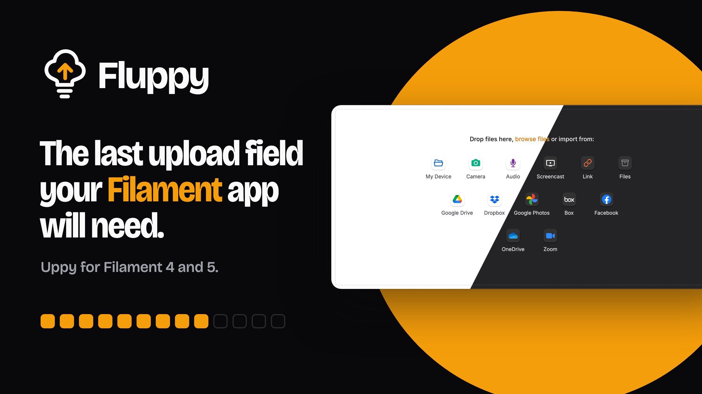
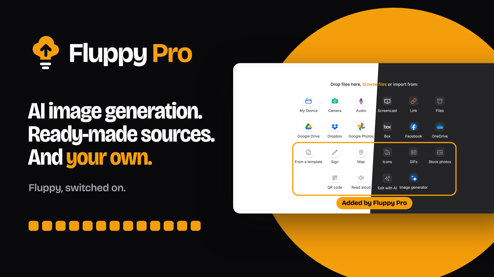

# Fluppy

[](https://packagist.org/packages/saade/fluppy)
[](https://packagist.org/packages/saade/fluppy)
[](https://github.com/saade/fluppy/actions/workflows/run-tests.yml)

<p align="center">
    
</p>

<video src="https://github.com/user-attachments/assets/87e822ef-f47d-4a8d-87bd-9d55d988cb38" controls></video>

Fluppy is an upload field for [Filament](https://filamentphp.com) forms, built on [Uppy](https://uppy.io). It extends Filament's own `FileUpload` field, so files are validated, stored and configured in the same way, and it adds:

- Chunked uploads for large files, which can be paused, resumed and retried
- Multipart uploads directly to S3
- Uploads from the camera, the microphone and the screen
- Imports from a URL, your application's own disks, Google Drive, Google Photos, Dropbox, OneDrive, Box, Zoom and Facebook, without [Companion](https://uppy.io/docs/companion/)

[Fluppy Pro](https://filamentphp.com/plugins/saade-fluppy-pro) is a paid package that builds on Fluppy. It adds:

- AI image generation, using the Laravel AI SDK or your own generator
- Custom sources, written as a class and a Blade view
- Ready-made sources for AI image editing, stock photos, icons, GIFs, signatures, QR codes, maps, templates and text to speech

<p align="center">
    <a href="https://filamentphp.com/plugins/saade-fluppy-pro"></a>
</p>

## Version compatibility

| Plugin | Filament | Install                                |
| ------ | -------- | -------------------------------------- |
| 1.x    | 4.x, 5.x | `composer require saade/fluppy:"^1.0"` |

## Table of contents

- [Installation](#installation)
- [Usage](#usage)
    - [Supported `FileUpload` methods](#supported-fileupload-methods)
    - [Unsupported `FileUpload` methods](#unsupported-fileupload-methods)
- [Adding sources](#adding-sources)
    - [Using the camera, microphone and screen](#using-the-camera-microphone-and-screen)
    - [Importing files from a URL](#importing-files-from-a-url)
    - [Importing files from a disk](#importing-files-from-a-disk)
    - [Google Drive](#google-drive)
    - [Google Photos](#google-photos)
    - [Dropbox](#dropbox)
    - [OneDrive](#onedrive)
    - [Box](#box)
    - [Zoom](#zoom)
    - [Facebook](#facebook)
    - [Storing tokens](#storing-tokens)
    - [Restricting who can connect](#restricting-who-can-connect)
- [Editing images](#editing-images)
- [Opening and downloading files](#opening-and-downloading-files)
- [Changing the layout](#changing-the-layout)
    - [Setting the height](#setting-the-height)
    - [Opening the uploader in a modal](#opening-the-uploader-in-a-modal)
- [Using Spatie's media library](#using-spaties-media-library)
- [Fluppy Pro](#fluppy-pro)
- [Uploading large files](#uploading-large-files)
    - [Configuring chunked uploads](#configuring-chunked-uploads)
    - [Choosing a chunk size](#choosing-a-chunk-size)
    - [Checking your setup](#checking-your-setup)
    - [Cleaning up unfinished uploads](#cleaning-up-unfinished-uploads)
    - [Using S3 as the temporary disk](#using-s3-as-the-temporary-disk)
- [Troubleshooting](#troubleshooting)
    - [Understanding upload limits](#understanding-upload-limits)
    - [Error messages](#error-messages)
    - [Resuming uploads](#resuming-uploads)
    - [Using multiple servers](#using-multiple-servers)
    - [Disk space and timeouts](#disk-space-and-timeouts)
    - [S3 errors](#s3-errors)
    - [The field is unstyled, or a source does nothing](#the-field-is-unstyled-or-a-source-does-nothing)
    - [Untested platforms](#untested-platforms)
- [Security](#security)
- [Styling](#styling)
- [Translations](#translations)
- [Testing](#testing)
- [Changelog](#changelog)
- [Contributing](#contributing)
- [Security Vulnerabilities](#security-vulnerabilities)
- [Credits](#credits)
- [License](#license)

## Installation

Fluppy requires PHP 8.2 or later. First, install the package via Composer:

```bash
composer require saade/fluppy:"^1.0"
```

Fluppy's styles are compiled by your panel's [custom theme](https://filamentphp.com/docs/5.x/styling/overview#creating-a-custom-theme). If your panel doesn't have a custom theme yet, follow Filament's documentation to create one first. Then, add the following lines to the theme's CSS file, which is `resources/css/filament/admin/theme.css` for a panel with the ID `admin`:

```css
@import '../../../../vendor/saade/fluppy/resources/css/fluppy.css';

@source '../../../../vendor/saade/fluppy/resources/views/**/*.blade.php';
```

Finally, rebuild your assets:

```bash
npm run build
```

There is no plugin to register in your panel. The field is ready to be used in any form.

Optionally, you can publish the configuration file, which this documentation refers to as `config/fluppy.php`:

```bash
php artisan vendor:publish --tag="fluppy-config"
```

## Usage

`FluppyField` is Filament's [file upload field](https://filamentphp.com/docs/5.x/forms/file-upload) with [Uppy](https://uppy.io) as its interface. You can use it anywhere you would use `FileUpload`:

```php
use Saade\Fluppy\Forms\Components\FluppyField;

FluppyField::make('attachments')
    ->disk('public')
    ->directory('attachments')
    ->multiple()
```

Files are uploaded through Livewire, and are validated and stored exactly like `FileUpload`'s.

The field works everywhere `FileUpload` does, including pages, modals and slide-overs, repeaters and builder blocks, relation managers, table actions, live forms and panels in SPA mode.

### Supported `FileUpload` methods

Since `FluppyField` extends `FileUpload`, you configure it using the same methods. As well as allowing static values, these methods also accept closures to dynamically calculate them. The following methods are supported:

| Method | Description |
| ------ | ----------- |
| `disk()`, `directory()`, `visibility()` and the other storage methods | Configure where and how files are stored |
| `multiple()`, `maxFiles()` | Allow multiple files to be uploaded, and limit how many |
| `acceptedFileTypes()`, `image()` | Restrict the types of files that can be uploaded |
| `maxSize()`, `minSize()` | Restrict the size of files, in kilobytes |
| `maxParallelUploads()` | Limit the number of parallel uploads, which is `2` by default |
| `reorderable()` | Allow users to reorder files by dragging them |
| `imageEditor()` | Allow users to crop, rotate and flip images. See [Editing images](#editing-images) |
| `openable()`, `downloadable()` | Allow stored files to be opened and downloaded. See [Opening and downloading files](#opening-and-downloading-files) |
| `previewable()` | Show previews of images, which is enabled by default |
| `deletable()` | Allow users to remove files |
| `disabled()` | Show the files without allowing them to be changed |

Fluppy also adds its own methods, which are documented in the following sections:

| Method | Section |
| ------ | ------- |
| `camera()`, `microphone()`, `screenCapture()` | [Using the camera, microphone and screen](#using-the-camera-microphone-and-screen) |
| `importFromUrl()`, `importFromDisk()`, `googleDrive()`, `googlePhotos()`, `dropbox()`, `oneDrive()`, `box()`, `zoom()`, `facebook()` | [Adding sources](#adding-sources) |
| `height()`, `modal()` | [Changing the layout](#changing-the-layout) |
| `chunked()`, `chunkSize()` | [Uploading large files](#uploading-large-files) |

These methods accept closures too. If a method enables a feature, you can also pass a boolean to it, to enable the feature conditionally:

```php
use Saade\Fluppy\Forms\Components\FluppyField;

FluppyField::make('attachments')
    ->camera(fn (): bool => auth()->user()->isAdmin())
```

### Unsupported `FileUpload` methods

The following `FileUpload` options belong to FilePond's interface, and have no effect on `FluppyField`:

- Automatic cropping and resizing of images, and the image editor methods listed in [Editing images](#editing-images).
- `avatar()`, `panelLayout()`, `appendFiles()`, `prependFiles()` and the methods that position buttons and indicators.

## Adding sources

A source is a button in the field that gives users another way to add files, apart from selecting them from their device. Each source is enabled using a method on the field, and its script is only loaded by the fields that use it.

Sources that import files from a URL or from another service are referred to as remote sources, since their files are downloaded by your server.

### Using the camera, microphone and screen

You may allow users to take a picture or record a video with their device's camera using the `camera()` method:

```php
use Saade\Fluppy\Forms\Components\FluppyField;

FluppyField::make('photo')
    ->image()
    ->camera()
```

Similarly, the `microphone()` method allows users to record audio with their device's microphone, and the `screenCapture()` method allows them to record their screen, a window or a browser tab:

```php
use Saade\Fluppy\Forms\Components\FluppyField;

FluppyField::make('recording')
    ->microphone()
    ->screenCapture()
```

Each method adds a button next to "My Device". Anything that is captured or recorded is uploaded like any other file, and must pass the same validation rules. If the field only accepts images, the camera will only take pictures, and if it only accepts videos, the camera will only record videos.

> [!NOTE]
> Browsers only grant access to the camera, the microphone and the screen on HTTPS pages and on `localhost`, and ask the user for permission the first time. If your app sends a `Permissions-Policy` header, it must allow `camera`, `microphone` and `display-capture` for your own origin.

### Importing files from a URL

You can allow users to import a file from a URL using the `importFromUrl()` method:

```php
use Saade\Fluppy\Forms\Components\FluppyField;

FluppyField::make('video')
    ->importFromUrl()
```

This adds a "Link" button to the field. When a user pastes a URL, the file is downloaded by your server, so it never passes through the user's device. Once it has been downloaded, it is treated like any other temporary upload, and must pass the field's validation rules as well as Livewire's.

A large file is downloaded in parts of 5 MB. The browser makes a short request to your server for each part, so you don't need a queue or a long-running request, and the user can see the progress of the import and pause it. You can change the size of a part, in kilobytes, using the `fluppy.remote.part_size` configuration option.

If the remote server does not support range requests, or does not report the size of the file, the file is downloaded in a single request instead. That request must finish within PHP's `max_execution_time` and within `fluppy.remote.timeout`, which is 60 seconds by default, and it shows no progress until it is done.

When S3 is the temporary disk, each part is sent from your server to the bucket as a part of a multipart upload.

#### Protecting against server-side request forgery

Since files are downloaded by your server, a malicious user could use this feature to make requests to your internal network. To prevent this, the URL is checked before anything is requested from it:

- Only `http` and `https` URLs are accepted, on ports 80 and 443 (`fluppy.remote.url.ports`), and without a username or password.
- Every IP address that the host name resolves to must be on the public internet. Loopback, private and link-local addresses are rejected, which includes the metadata endpoints of cloud providers.
- The connection is made to the IP address that was checked, which protects against DNS rebinding.
- Each redirect is checked in the same way before it is followed, up to a maximum of five.
- Only IPv4 addresses are resolved, so a file that is hosted on an IPv6-only server cannot be imported.

These checks require PHP's cURL extension, since it allows a connection to be made to a specific IP address.

If you wish to only allow certain hosts, you can list them in the `fluppy.remote.url.hosts` configuration option. A `*` matches any part of a host name:

```php
// config/fluppy.php
'remote' => [
    'url' => [
        'hosts' => ['files.example.com', '*.cdn.example.com'],
    ],
],
```

#### Rate limiting imports

By default, imports are rate limited to 600 requests per minute. You can change this using the `fluppy.remote.throttle` configuration option. The same limit applies to the requests that a field sends to a source for one session, such as listing the files in a folder. Files that are downloaded in a single request are limited to 60 per minute, which is the same limit that Livewire applies to uploads.

The route that downloads files only accepts requests from the session that a field prepared the import for.

> [!WARNING]
> A part is downloaded while a request waits, so a slow host can keep one of your PHP workers busy for up to `fluppy.remote.timeout` seconds. Before enabling remote sources on a publicly accessible form, you should consider lowering the timeout or restricting the allowed hosts.

### Importing files from a disk

You can allow users to select files that are already stored on one of your application's disks using the `importFromDisk()` method:

```php
use Saade\Fluppy\Forms\Components\FluppyField;

FluppyField::make('attachments')
    ->multiple()
    ->importFromDisk('s3', directory: 'brand-assets')
```

This adds a "Files" button to the field, which opens a file browser inside the field. The user can browse the directory and its subdirectories, and select files or entire folders. The selected files are copied by your server, in parts if they are large, so they never pass through the user's device.

The first argument is the name of any disk in `config/filesystems.php`. If you omit the directory, the entire disk can be browsed. You may change the label of the button using the `label` argument:

```php
use Saade\Fluppy\Forms\Components\FluppyField;

FluppyField::make('attachments')
    ->multiple()
    ->importFromDisk('s3', directory: 'brand-assets', label: 'Brand assets')
```

Each of these arguments accepts a closure as well as a static value. If the disk is `null`, the button is not shown.

The search input above the files searches by name on your server, in the open folder and all of its subfolders, and shows up to 200 results.

By default, files are shown as a list. The user can switch to a grid, which shows a preview of each image, using the button in the top right corner of the file browser. Their choice is remembered in their browser.

> [!WARNING]
> Anyone who can see the form can browse the directory and copy any file inside it, including the files in its subdirectories. You should use a directory that only contains files those users are allowed to see, or restrict what is listed.

#### Restricting which files are listed

If you'd like to decide which files and folders are listed, you can pass a closure as the `filterUsing` argument. You can inject the `$path` of each file or folder on the disk, and whether it `$isDirectory`, into the closure as parameters, along with anything else that Filament injects into a field's closures:

```php
use Saade\Fluppy\Forms\Components\FluppyField;

FluppyField::make('attachments')
    ->multiple()
    ->importFromDisk(
        's3',
        directory: 'contracts',
        filterUsing: fn (string $path, bool $isDirectory): bool => $isDirectory || auth()->user()->can('view', Contract::forPath($path)),
    )
```

The closure is called for folders as well as files, so it should return `true` for the folders that users may open. A file or folder that it excludes is not listed, is not found by a search, and cannot be opened or imported, even by a request that names it directly.

Files and folders whose names start with a dot are not listed. In the grid, images are shown with a preview if the disk supports temporary URLs, such as S3, or if its `visibility` is `public` in `config/filesystems.php`. The preview is the image itself, loaded by the browser, so a folder of large images will be slow to show as a grid.

All of the files in a folder are listed at once, so a folder with thousands of files will be slow to open.

### Google Drive

The `googleDrive()` method allows users to select files from their Google Drive:

```php
use Saade\Fluppy\Forms\Components\FluppyField;

FluppyField::make('attachments')
    ->multiple()
    ->googleDrive()
```

This adds a "Google Drive" button that opens the [Google Picker](https://developers.google.com/workspace/drive/picker/guides/overview). The user signs in to Google in a window that Google opens, and selects their files. Your server then downloads each file from Google, in parts if it is large.

To use Google Drive, you need a client ID, an API key and an app ID from a project in the [Google Cloud console](https://console.cloud.google.com/):

1. Enable the **Google Picker API** and the **Google Drive API** for the project.
2. Set up the OAuth consent screen with the `https://www.googleapis.com/auth/drive.file` scope.
3. Create an **OAuth client ID** of the type "Web application", with your app's origin (`https://your-app.com`) under "Authorized JavaScript origins". Google only signs a user in from an origin that is listed there, so every URL your app is served from needs its own entry. No redirect URI is needed.
4. Create an **API key**. If you restrict the key to certain APIs, the Picker API must be one of them. If the Picker opens with the message "The API developer key is invalid", check the key's restrictions first.
5. Copy the project number from the project's dashboard, which is the **app ID**.

Then, add the three values to your `.env` file:

```dotenv
FLUPPY_GOOGLE_CLIENT_ID=1234567890-abc.apps.googleusercontent.com
FLUPPY_GOOGLE_API_KEY=AIza...
FLUPPY_GOOGLE_APP_ID=1234567890
```

None of these values are secret, since Google's scripts need them in the page. If any of them is missing, a field that uses `googleDrive()` will throw an exception.

Your app only ever has access to the files that a user selects. This is what the `drive.file` scope means, and it is why Fluppy uses Google's Picker instead of Uppy's file browser, which would need access to the user's entire Drive.

There is no client secret, and nothing is stored on your server. The access token that Google gives the browser is kept there for the duration of the tab's session, and is sent to your server with each selected file to download it. Anything your server sends back that contains the token is encrypted. The token expires after about an hour, so if a file is still being downloaded by then, it will fail with a message that access has expired.

The Picker does not report the size of a file, so its size is only known once the upload starts. If the file is larger than the field or Livewire allows, it is rejected at that point.

> [!NOTE]
> The Picker and Google's sign-in are loaded from `apis.google.com` and `accounts.google.com`. If your app sends a `Content-Security-Policy` header, it must allow those scripts and the frames that Google opens.

#### Exporting Google Docs, Sheets and Slides

Documents that are created in Google's editors are not stored as files, so they are exported instead: Docs as `.docx`, Sheets as `.xlsx`, Slides as `.pptx`, Drawings as `.png`, and anything else as a PDF. An export is downloaded in a single request, and Google does not export documents larger than 10 MB.

If the field only accepts certain file types, a document is matched against the type that it will be exported to. For example, a field that accepts `.docx` files accepts a Google Doc, and a field that only accepts images does not.

### Google Photos

To allow users to select photos and videos from Google Photos, use the `googlePhotos()` method:

```php
use Saade\Fluppy\Forms\Components\FluppyField;

FluppyField::make('photos')
    ->multiple()
    ->googlePhotos()
```

This adds a "Google Photos" button that opens Google's [Photos picker](https://developers.google.com/photos/picker/guides/get-started-picker) in a new window. The user signs in and selects photos and videos there. Your server then downloads each one from Google, in parts if it is large.

Google Photos uses the same Google Cloud project and OAuth client as [Google Drive](#google-drive), with two additions:

1. Enable the **Google Photos Picker API** for the project.
2. Add the `https://www.googleapis.com/auth/photospicker.mediaitems.readonly` scope to the OAuth consent screen.

Only the client ID is required in your `.env` file. There is no API key and no app ID:

```dotenv
FLUPPY_GOOGLE_CLIENT_ID=1234567890-abc.apps.googleusercontent.com
```

If you wish to use a different client from the one that Google Drive uses, you can set the `fluppy.remote.google_photos.client_id` configuration option.

Like Google Drive, your app only has access to what a user selects, there is no client secret, and nothing is stored on your server. The token that Google gives the browser is sent to your server with each item, and is used to download it.

Each selected item is downloaded from a URL that Google returns with it, which expires after an hour. Your server only requests that URL if it is on the host that Google uses for user uploads, applies the same [SSRF protection](#protecting-against-server-side-request-forgery) as it does for a user-supplied URL, and does not forward the token if Google redirects to another host.

Photos are downloaded as the original file. If Google's response for the file does not include a name or a type, the ones that the picker reported are used.

### Dropbox

You can allow users to select files from their Dropbox using the `dropbox()` method:

```php
use Saade\Fluppy\Forms\Components\FluppyField;

FluppyField::make('attachments')
    ->multiple()
    ->dropbox()
```

This adds a "Dropbox" button. The first time a user clicks it, they are asked to connect their account: a window opens on Dropbox, they authorize your app, and the window closes. After that, the button opens a file browser inside the field, where they can select files or entire folders. Your server downloads what they select from Dropbox, in parts if a file is large.

To use Dropbox, you need an app in the [Dropbox App Console](https://www.dropbox.com/developers/apps):

1. Create an app with scoped access.
2. Under "Permissions", enable `account_info.read`, `files.metadata.read` and `files.content.read`.
3. Under "Settings", add the redirect URI `https://your-app.com/fluppy/sources/dropbox/callback`. Dropbox only redirects a user back to a URI that is listed there, so every URL your app is served from needs its own entry.
4. Copy the app key and the app secret to your `.env` file:

```dotenv
FLUPPY_DROPBOX_CLIENT_ID=your-app-key
FLUPPY_DROPBOX_CLIENT_SECRET=your-app-secret
```

If either of them is missing, a field that uses `dropbox()` will throw an exception.

Dropbox does not return the MIME type of a file, so the type is guessed from the file's extension. If the field only accepts certain file types, the files that don't match are disabled in the file browser based on that guess. The file itself is still validated against your rules once it has been downloaded.

The user's tokens are [stored on your server](#storing-tokens), and you can [restrict who can connect](#restricting-who-can-connect) an account.

### OneDrive

The `oneDrive()` method allows users to select files from their OneDrive:

```php
use Saade\Fluppy\Forms\Components\FluppyField;

FluppyField::make('attachments')
    ->multiple()
    ->oneDrive()
```

OneDrive works like [Dropbox](#dropbox): a "OneDrive" button, a window to connect the first time, and then a file browser inside the field. The user's tokens are also [stored on your server](#storing-tokens).

> [!WARNING]
> OneDrive has been tested against a mock of Microsoft's API, and not yet against Microsoft itself. If it does not work with your app registration, please open an issue.

To use OneDrive, you need an app registered in [Microsoft Entra](https://entra.microsoft.com/) (App registrations > New registration):

1. Choose which accounts may sign in. This choice must match the tenant that you configure below.
2. Add a redirect URI of the type "Web": `https://your-app.com/fluppy/sources/onedrive/callback`.
3. Under "API permissions", add the delegated Microsoft Graph permissions `Files.Read`, `User.Read` and `offline_access`.
4. Under "Certificates & secrets", create a client secret, and copy its value. Copy the application (client) ID from the overview.

Then, add them to your `.env` file, along with the tenant:

```dotenv
FLUPPY_ONEDRIVE_CLIENT_ID=00000000-0000-0000-0000-000000000000
FLUPPY_ONEDRIVE_CLIENT_SECRET=the-value-of-the-secret
FLUPPY_ONEDRIVE_TENANT=common
```

By default, the tenant is `common`, which allows personal, work and school accounts. You can use `consumers` for personal accounts only, `organizations` for work and school accounts only, or the ID or domain of a single organization to only allow its users.

> [!NOTE]
> A client secret in Entra expires, and the portal offers a lifetime of up to two years. Once it has expired, connecting fails until you set a new one.

When your server requests a file, Microsoft responds with a URL on another host, which is valid for a few minutes, and your server downloads the file from there. That URL goes through the same [SSRF protection](#protecting-against-server-side-request-forgery) as a user-supplied URL, and the user's token is never sent to it. The hosts that you allow in `fluppy.remote.url.hosts` do not apply to it.

Only the contents of the user's own OneDrive are listed. Notebooks, and other items that are neither a file nor a folder, are excluded.

### Box

To allow users to select files from their Box account, use the `box()` method:

```php
use Saade\Fluppy\Forms\Components\FluppyField;

FluppyField::make('attachments')
    ->multiple()
    ->box()
```

Box works like [Dropbox](#dropbox) and OneDrive: a button, a window to connect the first time, and then a file browser inside the field, with the user's tokens [stored on your server](#storing-tokens).

To use Box, you need a custom app in the [Box Developer Console](https://app.box.com/developers/console):

1. Click "New App" and choose the "User" app type, which is the one for apps where users link their own Box accounts. A "Server" app, which is what a new developer account starts with, has no place to enter a redirect URI and cannot be used.
2. Under "Configuration", add the redirect URI `https://your-app.com/fluppy/sources/box/callback`.
3. Under "Application Scopes" > "Content Actions", keep both "Read all files and folders stored in Box" and "Write all files and folders stored in Box" checked. According to Box's console, the second is required to download files. Fluppy never writes to a user's Box.
4. Copy the client ID and the client secret to your `.env` file:

```dotenv
FLUPPY_BOX_CLIENT_ID=your-client-id
FLUPPY_BOX_CLIENT_SECRET=your-client-secret
```

Like Microsoft, Box responds to a download request with a short-lived URL on another host. Your server downloads the file from there, with the same [SSRF protection](#protecting-against-server-side-request-forgery) as a user-supplied URL, and does not forward the user's token.

Like Dropbox, Box does not return the MIME type of a file, so the type is guessed from the file's extension. Bookmarks, which Box lists alongside files, are excluded.

### Zoom

You can allow users to select from their Zoom cloud recordings using the `zoom()` method:

```php
use Saade\Fluppy\Forms\Components\FluppyField;

FluppyField::make('recordings')
    ->multiple()
    ->zoom()
```

This allows a user to connect their Zoom account and select from its cloud recordings, which are the videos, audio, chats and transcripts of the meetings they recorded. Connecting works like [Dropbox](#dropbox), and the user's tokens are also [stored on your server](#storing-tokens).

> [!WARNING]
> Zoom has been tested against a mock of Zoom's API, and not yet against Zoom itself. If it does not work with your app, please open an issue.

Zoom has no folders, and only returns recordings for up to one month at a time, so the file browser shows a folder for each month since the account was created. Each recording is named after the meeting, its time and the type of the file.

To use Zoom, you need an app in the [Zoom App Marketplace](https://marketplace.zoom.us/) (Develop > Build App > General App):

1. Under "Basic Information", choose how the app is managed, and add `https://your-app.com/fluppy/sources/zoom/callback` as the OAuth redirect URL and to the allow list.
2. Under "Scopes", add the scopes that allow the app to read a user's own recordings and profile: `cloud_recording:read:list_user_recordings`, `cloud_recording:read:list_recording_files` and `user:read:user`.
3. Copy the client ID and the client secret to your `.env` file:

```dotenv
FLUPPY_ZOOM_CLIENT_ID=your-client-id
FLUPPY_ZOOM_CLIENT_SECRET=your-client-secret
```

> [!NOTE]
> Until Zoom has reviewed and published your app, only users of your own Zoom account can connect to it.

Cloud recording is only available on Zoom's paid plans. An account without it can connect, but will have nothing to list. Recordings that Zoom is still processing are not listed either.

Zoom's download URL requires the user's token, so your server only sends the token to a `zoom.us` host, and drops it when Zoom redirects the request to where the file is stored.

### Facebook

The `facebook()` method allows users to select from their Facebook photos:

```php
use Saade\Fluppy\Forms\Components\FluppyField;

FluppyField::make('photos')
    ->image()
    ->multiple()
    ->facebook()
```

This allows a user to connect their Facebook account and select from their photos. Their albums are shown as folders, and the photos inside an album are shown as a grid of thumbnails. Each selected photo is downloaded at the largest size that Facebook stores.

To use Facebook, you need an app at [Meta for Developers](https://developers.facebook.com/apps/):

1. Create an app. When you are asked what the app is for, choose the use case "Authenticate and request data from users with Facebook Login".
2. Open "Use cases" in the app's menu and click "Customize" on that use case. Two of its pages matter, both listed on the left: "Permissions and features" and "Settings".
3. On "Settings", under "Valid OAuth Redirect URIs", type `https://your-app.com/fluppy/sources/facebook/callback` and **select it from the dropdown that opens below the field**, so that it is added as its own entry. Then click "Save changes" at the bottom of the page. If you press Enter instead, the page is saved without the URI, and Facebook keeps rejecting it with "The domain of this URL isn't included in the app's domains".
4. On "Permissions and features", find `user_photos`. Its status must be "Ready for testing". If it is not, click "Add" on its row.
5. Open "App settings" > "Basic", and copy the app ID and the app secret to your `.env` file:

```dotenv
FLUPPY_FACEBOOK_CLIENT_ID=your-app-id
FLUPPY_FACEBOOK_CLIENT_SECRET=your-app-secret
```

> [!NOTE]
> While the app is unpublished, only users with a role on it (admins, developers and testers) can connect. For anyone else, Meta must approve `user_photos` in App Review, and the app must be published.

The user's tokens are [stored on your server](#storing-tokens). Facebook does not provide a refresh token, so your server exchanges the token it receives for one that lasts about sixty days, and asks the user to connect again after that, or sooner if their session ends first.

A photo on Facebook has no file name, so it is named after the date it was uploaded and its ID, for example `2026-09-03 1234567890.jpg`.

Your server downloads photos from Facebook's CDN, with [SSRF protection](#protecting-against-server-side-request-forgery) and without the user's token.

> [!NOTE]
> The thumbnails in the grid are loaded by the browser directly from the same CDN. If your app sends a `Content-Security-Policy` header, its `img-src` directive must allow `*.fbcdn.net`.

### Storing tokens

When a user connects their Dropbox, OneDrive, Box, Zoom or Facebook account, the tokens never reach the browser. Your server exchanges the provider's response for them and stores them in the user's session, encrypted using your application key.

The tokens are discarded when the session ends. They are also discarded when the user clicks "Log out" in the file browser, which revokes them with Dropbox, Box, Zoom and Facebook as well.

If you'd like a connection to outlive the session, you can bind your own implementation of the `TokenStore` interface in a service provider. It has three methods, `get()`, `put()` and `forget()`, and each of them receives the ID of the source:

```php
use App\Support\DatabaseTokenStore;
use Saade\Fluppy\Sources\Support\TokenStore;

$this->app->bind(TokenStore::class, DatabaseTokenStore::class);
```

### Restricting who can connect

By default, the two routes that a user connects through, `fluppy/sources/{source}/connect` and `fluppy/sources/{source}/callback`, are accessible to guests, since a field may be used on a public form. A guest can only connect their own account to their own session, and a connection does nothing until a field uses it.

If you wish to restrict these routes to authenticated users, you can set the `fluppy.remote.connect_middleware` configuration option to `['auth']`, or to `['auth:admin']` for a different guard.

## Editing images

You can allow users to edit images using the `imageEditor()` method:

```php
use Saade\Fluppy\Forms\Components\FluppyField;

FluppyField::make('photos')
    ->image()
    ->multiple()
    ->imageEditor()
```

Each uploaded image gets an edit button, which opens [Uppy's image editor](https://uppy.io/docs/image-editor/), where the user can crop, rotate, flip and zoom the image. Saving uploads the edited image in place of the original. Images that have already been stored can be edited too. Since the browser downloads them first, they must be served from the same domain as your app, or the appropriate CORS headers need to be present.

The editor is Uppy's and not the one that `FileUpload` uses, so only some of Filament's image editor methods are supported:

| Method | Description |
| ------ | ----------- |
| `imageEditor()` | Enable the editor. Its script is only loaded by the fields that use it |
| `imageEditorAspectRatioOptions()` | Limit the aspect ratios that are offered. Uppy supports three: `1:1`, `16:9` and `9:16`. Any other ratio is ignored |
| `automaticallyCropImagesToAspectRatio()` | Restrict the editor to the given aspect ratio. The image is not cropped automatically, so the user must open the editor |

The `imageEditorMode()`, `imageEditorViewportWidth()`, `imageEditorViewportHeight()`, `imageEditorEmptyFillColor()` and `circleCropper()` methods have no effect, and automatic resizing is not supported.

## Opening and downloading files

You can turn the preview of a stored file into a link that opens it in a new tab using the `openable()` method, and add a download button using the `downloadable()` method:

```php
use Saade\Fluppy\Forms\Components\FluppyField;

FluppyField::make('attachments')
    ->multiple()
    ->openable()
    ->downloadable()
```

Both use the URL of the file on its disk, or the URL that you return from `getOpenableFileUrlUsing()` and `getDownloadableFileUrlUsing()`.

## Changing the layout

### Setting the height

By default, the uploader is rendered inside the form and is 320 pixels tall. You may change its height using the `height()` method, which is useful to give the image editor more room:

```php
use Saade\Fluppy\Forms\Components\FluppyField;

FluppyField::make('photo')
    ->image()
    ->imageEditor()
    ->height(480)
```

### Opening the uploader in a modal

If you'd like the field to take up less space, you can use the `modal()` method:

```php
use Saade\Fluppy\Forms\Components\FluppyField;

FluppyField::make('attachments')
    ->multiple()
    ->modal()
```

The form then shows a button and a list of the field's files, each with its size or upload progress and a button to remove it. Clicking the button opens the uploader in a modal, where files can be added, edited and reordered.

The modal can be closed using its close button, by pressing the Escape key or by clicking away, and it can be opened from a field that is itself inside a Filament modal.

## Using Spatie's media library

If you're using [Filament's media library plugin](https://filamentphp.com/plugins/filament-spatie-media-library), you can use `SpatieMediaLibraryFluppyField` anywhere you would use `SpatieMediaLibraryFileUpload`. It extends that field, so it has the same options, and everything in this documentation applies to it. First, make sure that the plugin is installed:

```bash
composer require filament/spatie-laravel-media-library-plugin
```

Then, use the field in your form:

```php
use Saade\Fluppy\Forms\Components\SpatieMediaLibraryFluppyField;

SpatieMediaLibraryFluppyField::make('attachments')
    ->collection('attachments')
    ->multiple()
```

There is one difference. The plugin's field reads each uploaded file into memory to pass it to the media library, which does not work for a large file. `SpatieMediaLibraryFluppyField` points the media library at the file on the temporary disk instead, and the library copies it from there as a stream.

## Fluppy Pro

[Fluppy Pro](https://filamentphp.com/plugins/saade-fluppy-pro) is a paid package that builds on this one. It installs this package with it, and its field extends `FluppyField`, so everything in this documentation applies to it. What it adds is covered in [its own documentation](https://filamentphp.com/plugins/saade-fluppy-pro).

## Uploading large files

A file that is larger than one chunk (900 KB by default) is uploaded in chunks, each in its own request, and assembled on Livewire's temporary disk. From there, it is an ordinary temporary upload, which is validated and stored in the same way as any other. This means that a file can be larger than PHP or your web server accept in a single request, and that an upload can be paused, resumed and retried. If the same file is selected again after the page is reloaded, the upload continues from the chunks that have already arrived.

Chunked uploads work without any configuration. However, **Livewire's validation rules for temporary uploads only allow files of up to 12 MB by default**, and they apply to the assembled file. You should raise this limit in `config/livewire.php` to the largest file that your app should accept:

```php
'temporary_file_upload' => [
    'rules' => ['required', 'file', 'max:1048576'], // 1 GB, in kilobytes
],
```

If a file is over that limit, or outside the field's `maxSize()` and `minSize()`, it is rejected before any of it is uploaded, and the reason is shown on the file.

### Configuring chunked uploads

By default, large files are uploaded in chunks. You can disable this for a field by passing `false` to the `chunked()` method, or change the size of its chunks, in kilobytes, using the `chunkSize()` method:

```php
use Saade\Fluppy\Forms\Components\FluppyField;

FluppyField::make('video')
    ->chunkSize(512)
```

If you wish to change the defaults for every field, you can [publish the configuration file](#installation) and change its `chunking` options:

```php
'chunking' => [
    'enabled' => true,
    'chunk_size' => 900, // kilobytes
    's3_part_size' => 5120, // kilobytes
    'throttle' => '600,1', // requests,minutes for the chunk route
],
```

### Choosing a chunk size

Each chunk must still fit in a single request:

- The chunk size is lowered automatically to what PHP's `upload_max_filesize` and `post_max_size` allow.
- Your web server's limit cannot be read from PHP. By default, nginx allows 1 MB (`client_max_body_size`), which is why the default chunk size is just under that. If you raise the chunk size, you should raise that limit as well, along with the limit of any proxy or CDN in front of your app.

Larger chunks mean fewer requests. With the default rate limit of 600 chunks per minute, 900 KB chunks top out at about 9 MB per second. Chunks have their own rate limit, so a large upload does not use up the 60 requests per minute that Livewire allows for its own uploads, or the rate limit of any other route.

A file that is no larger than one chunk is sent to Livewire in a single request, like `FileUpload` does.

### Checking your setup

You can check everything that a large upload passes through using the `fluppy:doctor` Artisan command:

```bash
php artisan fluppy:doctor
```

The command reports anything that would prevent an upload from succeeding:

- The largest file that Livewire's rules allow, and whether that is still the 12 MB default.
- The chunk size, and whether it was lowered to fit PHP's limits. Since PHP may be configured differently on the command line, the command asks the running app for them.
- Whether a chunk of that size reaches your app, or is rejected by the web server. It sends one to find out.
- When S3 is the temporary disk, whether the bucket can be reached, how many multipart uploads are open, whether CORS allows `PUT` requests from your app, and whether a lifecycle rule aborts incomplete uploads.
- Whether `fluppy:prune` is scheduled.

The command exits with an error if something would cause uploads to fail, so you can run it as part of your deployment.

| Option | Description |
| ------ | ----------- |
| `--disk=` | A disk that your fields store files on, to check whether saving to it [copies the file within S3](#saving-files-without-passing-them-through-your-server). May be passed more than once |
| `--url=` | The URL of your app as a browser reaches it, if it is not `APP_URL` |

### Cleaning up unfinished uploads

An upload that is never finished leaves its chunks on the temporary disk, or an open multipart upload in the bucket. To remove them, you should schedule the `fluppy:prune` Artisan command:

```php
use Illuminate\Support\Facades\Schedule;

Schedule::command('fluppy:prune')->daily();
```

By default, the command removes anything that has not changed in 24 hours, which you can change using the `--hours` option. This includes chunks, multipart uploads that were started and never completed, and, when S3 is not the temporary disk, temporary uploads that were never saved, like Livewire does for its own.

### Using S3 as the temporary disk

When [Livewire's temporary disk is S3](https://livewire.laravel.com/docs/uploads#storing-uploaded-files-on-s3), the browser uploads files directly to the bucket. A file that is larger than one part (5 MB, which is the minimum that S3 accepts) is sent as a multipart upload: your server starts the upload and signs a URL for each part, the browser uploads the parts, and your server completes the upload. Pausing, resuming and retrying work as they do for chunked uploads, and a file that is selected again continues from the parts that the bucket already has.

This requires the `league/flysystem-aws-s3-v3` package, as all S3 disks do.

#### Configuring CORS

The bucket must accept `PUT` requests from your app's origin, as it already must for Livewire's own uploads to S3. It does not need to expose the `ETag` header, since the parts are read back from S3 when the upload is completed. You should allow your own origin instead of every origin:

```json
[
    {
        "AllowedOrigins": ["https://your-app.com"],
        "AllowedMethods": ["PUT"],
        "AllowedHeaders": ["*"],
        "MaxAgeSeconds": 3000
    }
]
```

#### Granting permissions

The credentials of the temporary disk need no more than the following permissions on the temporary bucket:

```json
{
    "Effect": "Allow",
    "Action": [
        "s3:PutObject",
        "s3:GetObject",
        "s3:DeleteObject",
        "s3:AbortMultipartUpload",
        "s3:ListMultipartUploadParts"
    ],
    "Resource": "arn:aws:s3:::your-temporary-bucket/livewire-tmp/*"
}
```

The `s3:ListBucketMultipartUploads` permission, on the bucket itself, is only used by the `fluppy:doctor` command.

#### Setting the part size

You can change the size of a part, in kilobytes, using the `fluppy.chunking.s3_part_size` configuration option. The `chunkSize()` method and the `chunk_size` option only apply to chunks that are sent through PHP.

#### Aborting abandoned uploads

Removing a file aborts its multipart upload in S3. However, an upload that is abandoned, for example by closing the tab, stays in the bucket and is billed until it is aborted. The [`fluppy:prune`](#cleaning-up-unfinished-uploads) command aborts the ones that it knows about. You should also add a lifecycle rule to the bucket that aborts incomplete multipart uploads after about a day, which catches the rest and removes temporary files that were never saved.

#### Using S3-compatible services

Any service that Laravel's `s3` driver supports should work, since Fluppy only uses standard multipart requests and presigned URLs. The following services have been tested:

| Service | Notes |
| ------- | ----- |
| Cloudflare R2 | Works, including the copy on save. Use `'region' => 'auto'` and `'use_path_style_endpoint' => true`. A new bucket has no CORS rules, so you must add the one above. R2 already aborts incomplete multipart uploads after 7 days |
| MinIO | Works, including the copy on save. It allows every origin by default, and has no per-bucket CORS or lifecycle rules to read |

The `fluppy:doctor` command cannot read a bucket's CORS and lifecycle rules with a key that is only allowed to read and write objects. It reports this, and uploads are not affected.

#### Saving files without passing them through your server

`FileUpload` saves a file by reading it from the temporary disk and writing it to the final disk, so the entire file passes through PHP. On a server with a time limit, such as a serverless function, a large file does not survive that.

When the temporary disk and the field's `disk()` are both S3, `FluppyField` has S3 copy the file instead, so nothing passes through your server, either during the upload or when the form is saved. This requires no configuration, and works:

- Within a bucket, and from one bucket to another.
- For files of any size. Above 5 GB, which is the most that S3 copies in a single request, the file is copied in parts.

To copy between two buckets, both disks must use the same S3 service (the same `endpoint`), and the credentials of the field's disk must be allowed to read the temporary bucket. If S3 rejects the copy, the error is reported and the file is saved in the usual way.

## Troubleshooting

If uploads are failing, start by running `php artisan fluppy:doctor`, which checks most of the following on the server it runs on. See [Checking your setup](#checking-your-setup).

### Understanding upload limits

An upload passes through several layers, and each has its own limit. Uploading in chunks keeps a file under all of them except one:

| A file fails at about | The limit | With `FluppyField` |
| --------------------- | --------- | ------------------ |
| 1 MB | nginx, `client_max_body_size` | Not reached, since a chunk is 900 KB |
| 2 MB or 8 MB | PHP, `upload_max_filesize` and `post_max_size` | Not reached, since the chunk size is lowered to fit them |
| 12 MB | Livewire, the `max:12288` rule for temporary uploads | **Still applies**, to the whole file. Raise it in `config/livewire.php`, as shown in [Uploading large files](#uploading-large-files) |
| 100 MB | Cloudflare, on its Free and Pro plans (200 MB on Business) | Not reached, since each request carries one chunk |
| the field's `maxSize()` | The field | Applies |

Apache's `LimitRequestBody` directive, and the limit of any other proxy in front of your app, behave like nginx's: they only matter if they are lower than the size of a chunk.

### Error messages

When a file fails to upload, the reason is shown on the file itself.

- **"The file is larger than the 12 MB allowed."** (or another size) The file was rejected before any of it was uploaded, by the lower of the field's `maxSize()` and Livewire's validation rule. 12 MB is Livewire's default.
- **"The file could not be uploaded."**, with no other message. A request did not receive a response from your app. Open your browser's network tab and check the status of the request to `fluppy/chunks` (for a chunked upload) or `livewire/upload-file` (for a file that is small enough to be sent in a single request):
  - **413.** Your web server or a proxy rejected the request as too large. This only happens if `chunk_size` was raised above what they accept, or if a proxy accepts less than 1 MB. Lower the chunk size, or raise the limit.
  - **429 on `livewire/upload-file`.** Livewire's own rate limit of 60 uploads per minute per user was exceeded (`livewire.temporary_file_upload.middleware`).
  - **No status.** The connection dropped. A chunked upload has already tried each chunk four times, waiting longer each time. Retrying the file continues from the chunks that arrived.
- **"Too Many Attempts."** The rate limit of the chunk route (`fluppy.chunking.throttle`, 600 per minute by default) was exceeded, and was still exceeded after the upload waited and retried. You can raise it if your users upload several large files at once.
- **"CSRF token mismatch."** The session expired while the page was open. Reloading the page and selecting the file again starts a new upload.
- **"Invalid chunked upload reference."** The upload was started in a different session, for example if the user signed in again in another tab. Selecting the file again starts a new upload.
- **"The chunked upload is incomplete."** Chunks that had arrived were missing when the file was assembled. See [Using multiple servers](#using-multiple-servers) and [Cleaning up unfinished uploads](#cleaning-up-unfinished-uploads).

A `401` response from `fluppy/chunks` during a long upload is expected, and is not shown to the user. The route's URL is signed for as long as Livewire's `max_upload_time` (5 minutes by default), and the upload requests a new one and continues.

The following messages are shown for files that are downloaded by a [source](#adding-sources):

- **"Files cannot be fetched from there."** The URL did not pass the [SSRF protection](#protecting-against-server-side-request-forgery), is not allowed by `fluppy.remote.url.hosts`, or the source is not one that the field offers.
- **"The file could not be fetched from where it is."** The remote server could not be reached, or did not respond within `fluppy.remote.timeout`.
- **"Access to the file was refused or has expired. Connect again and add the file once more."** The source no longer accepts the user's token.
- **"The file could not be fetched: its server answered 404."** (or another status) The remote server responded with an error.

### Resuming uploads

If a file is selected again, its upload continues from what has already arrived, as long as it is the same file (name, size, type and last modified date), it is selected in the same session, and its chunks have not been removed by [`fluppy:prune`](#cleaning-up-unfinished-uploads) yet, which keeps unfinished uploads for 24 hours by default. Signing out, or anything else that starts a new session, restarts the upload from the beginning.

### Using multiple servers

Chunks are stored on Livewire's temporary disk until the last one arrives. If that disk is a local directory and requests are distributed over multiple servers, the chunks of a file end up on different machines and are never assembled. This is also the case for Livewire's own uploads, and the solutions are the same: use a temporary disk that all of the servers share, such as [S3](#using-s3-as-the-temporary-disk), or a load balancer with sticky sessions. The cache store should be shared as well, since a lock in it prevents two requests from assembling the same file.

The URLs that Fluppy signs do not include the host. If your app is behind a proxy, and is reached under a different host or scheme than it expects, they remain valid instead of failing with "invalid signature".

### Disk space and timeouts

The request that delivers the last chunk assembles the file, so it takes longer for larger files, and must finish within PHP's `max_execution_time` and your web server's timeouts. During assembly, the file is first written to the system's temporary directory (`sys_get_temp_dir()`) and then stored on the temporary disk, so both need enough free space for it. None of this applies when S3 is the temporary disk, since the bucket assembles the parts.

### S3 errors

- **The browser console reports a CORS error for a `PUT` request to the bucket.** The bucket has no rule that allows `PUT` requests from your app's origin. See [Configuring CORS](#configuring-cors). The `fluppy:doctor` command reads the bucket's rules if its key is allowed to.
- **A part receives a `403` response.** Occasionally, this is a presigned URL that has expired, and the part is retried with a new one. If every part is rejected, the credentials of the temporary disk are missing one of the [required permissions](#granting-permissions).
- **S3's limit of 5 GB for a single `PUT` request** is never reached, since a file that is larger than one part is always uploaded in parts.

### The field is unstyled, or a source does nothing

- **The field is unstyled.** The plugin's stylesheet is not imported in the panel's theme, or the theme has not been rebuilt since it was. See [Installation](#installation).
- **The camera, microphone or screen source does nothing.** Browsers only grant access to them on HTTPS pages and on `localhost`, and a `Permissions-Policy` header can deny it. See [Using the camera, microphone and screen](#using-the-camera-microphone-and-screen).
- **Google's Picker does not open.** A `Content-Security-Policy` header must allow Google's scripts and frames, and your app's origin must be listed in the OAuth client. See [Google Drive](#google-drive).

### Untested platforms

Fluppy has not been tested on Laravel Vapor, Laravel Cloud or Octane yet. On Vapor, where requests through Lambda are limited to roughly 4.5 MB and the server's disk is not persistent, you should expect to need S3 as the temporary disk. If you run the field on any of these, please open an issue to share how it went.

## Security

Before using the field on a publicly accessible form, you should be aware of the following.

### Access to the upload routes

Anyone who can use a form that contains the field can upload files, like with `FileUpload`. The two routes that Fluppy adds for uploads, `fluppy/chunks` and `fluppy/remote`, only respond to a URL that your app signed, with a reference that a field issued to the same session, so they cannot be used by anyone who was not shown the form.

A field on a public form allows guests to fill your temporary storage, like `FileUpload` does. Nothing is stored permanently until the form is saved.

### Signed upload data

The disk, the directory and the name that a file is stored under are determined by the field, on the server. Everything that a field gives the browser to send back, such as the size of the file, the number of chunks and the session, is signed using your `APP_KEY`. Each chunk must be exactly the expected size, and the assembled file must be exactly the size that was declared when the upload started. If your app has no key, Fluppy refuses to sign anything.

### File validation

A file that is assembled on your server, either from chunks or by downloading it from a source, is validated against Livewire's rules for temporary uploads once it is complete. A file that is uploaded to S3 in parts must be exactly the size that was declared when the upload started, and that size is subject to the same size limits.

From there, each is an ordinary temporary upload, so `acceptedFileTypes()`, `maxSize()` and your own rules are applied to it when the form is saved, exactly like they are for any other file.

### Rate limits

Each of Fluppy's rate limits is counted separately, per authenticated user, or per IP address for guests:

- 600 chunks per minute (`fluppy.chunking.throttle`)
- 600 requests per minute to download remote files (`fluppy.remote.throttle`)
- 60 requests per minute to connect an account

### Temporary files

Unfinished uploads remain in temporary storage until they are removed. You should schedule the [`fluppy:prune`](#cleaning-up-unfinished-uploads) command and, when using S3, add the lifecycle rule described in [Aborting abandoned uploads](#aborting-abandoned-uploads).

### Remote sources

Remote sources are disabled until a field enables one. When one is enabled, your server makes requests on behalf of anyone who uses the form. See [Protecting against server-side request forgery](#protecting-against-server-side-request-forgery) for the checks that restrict those requests to the public internet, and [Storing tokens](#storing-tokens) for where the tokens of connected accounts are stored.

A field that uses `importFromDisk()` lets anyone who can see the form browse and copy the files of its directory. See [Importing files from a disk](#importing-files-from-a-disk).

Accounts are connected using OAuth's authorization code flow with PKCE. The callback must carry the random `state` value that your server stored in the session when the window was opened, so a link cannot be used to connect a user's session to somebody else's account. If you wish to only allow authenticated users to connect an account, you can use the `fluppy.remote.connect_middleware` configuration option, as described in [Restricting who can connect](#restricting-who-can-connect).

### S3 permissions

You should give the credentials of the temporary disk no more than the [permissions it needs](#granting-permissions), and only allow your own origin in the bucket's [CORS rules](#configuring-cors).

### The doctor route

The `fluppy/doctor` route only responds to a URL that the `fluppy:doctor` command signed within the last five minutes, and only returns PHP's two upload limits and the chunk size.

To report a vulnerability, see [Security Vulnerabilities](#security-vulnerabilities).

## Styling

The field uses your panel's `gray`, `primary`, `danger` and `success` colors, and follows its light and dark mode.

Every element that Fluppy renders has a class that starts with `fi-fluppy`, which you may target from your theme. Uppy's own elements keep their `uppy-` classes, which you may style inside `.fi-fluppy`:

```css
.fi-fluppy .uppy-Dashboard-inner {
    @apply rounded-xl;
}
```

| Class | Element |
| ----- | ------- |
| `.fi-fluppy` | The field |
| `.fi-fluppy-reorderable` | The field, when its files can be reordered |
| `.fi-fluppy-summary` | The button and the list of files that a field using `modal()` shows in the form |
| `.fi-fluppy-summary-files`, `.fi-fluppy-summary-file` | The list of files, and a single file in it |
| `.fi-fluppy-summary-file-name`, `.fi-fluppy-summary-file-status` | The name of a file, and its size, progress or error |
| `.fi-fluppy-summary-file-failed` | A file that could not be uploaded |
| `.fi-fluppy-modal` | The element at the end of the page that contains the uploader of a field using `modal()`. It also has the `.fi-fluppy` class |

## Translations

The field uses your app's locale. Uppy's interface is translated by its own [locale packs](https://uppy.io/docs/locales/), and the one that matches `app()->getLocale()` is loaded when the field is rendered. For example, `pt_BR` and `pt-BR` load Brazilian Portuguese, `pt` loads the first Portuguese pack, and a locale that Uppy has no pack for falls back to English.

The messages that Fluppy adds are in its own translation files. To change them, or to add a language, you may publish them:

```bash
php artisan vendor:publish --tag="fluppy-translations"
```

## Testing

You can run the package's tests using Composer:

```bash
composer test
```

Some of the tests use a real browser, which must be installed once:

```bash
npm install
npx playwright install chromium
```

To only run the tests that do not need a browser, use `vendor/bin/pest --testsuite=Feature`.

## Changelog

Please see [CHANGELOG](CHANGELOG.md) for more information on what has changed recently.

## Contributing

Please see [CONTRIBUTING](.github/CONTRIBUTING.md) for details.

## Security Vulnerabilities

Please review [our security policy](../../security/policy) on how to report security vulnerabilities.

## Credits

- [Saade](https://github.com/saade)
- [All Contributors](../../contributors)

## License

The MIT License (MIT). Please see [License File](LICENSE.md) for more information.
